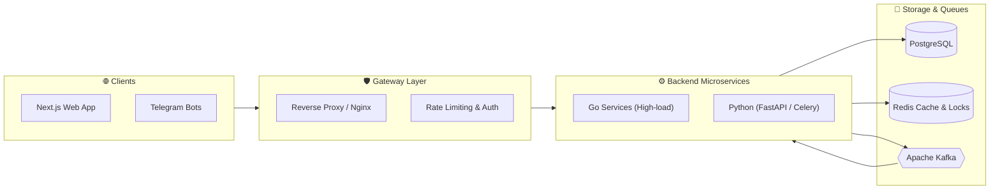

  <!-- Header Banner -->
  

  <!-- Animated Typing SVG -->
  

    

  <!-- Social & Info Badges -->
  

    
    
    
  

---

### ⚡ Men haqimda (About Me)

- 🔭 **Asosiy yo'nalish:** Katta yuklamaga bardosh beruvchi mikroxizmatlar, taqsimlangan tizimlar va ma'lumotlar bazasi optimizatsiyasi.
- 🛠 **Fokus:** Go, Python, PostgreSQL indeksatsiyasi (B-Tree, BRIN), Redis Distributed Caching va Kafka xabarlar navbati.
- 🌐 **Fullstack:** Next.js 15 (App Router), TypeScript va zamonaviy SSR web ilovalari.
- 💬 **Suhbat uchun mavzular:** High-Load arxitektura, System Design, Zero-Downtime deployments va API xavfsizligi.

---

### 📐 Tizim Arxitekturasi (Backend Architecture Flow)

---

### 🛠 Texnologik Stek (Tech Stack)

<table>
  <tr>
    <td align="left"><b>Backend & Core</b></td>
    <td>
      
      
      
      
      
    </td>
  </tr>
  <tr>
    <td align="left"><b>Databases & Queues</b></td>
    <td>
      
      
      
      
      
    </td>
  </tr>
  <tr>
    <td align="left"><b>Frontend & DevOps</b></td>
    <td>
      
      
      
      
      
      
    </td>
  </tr>
</table>

---

### 📊 GitHub Faolligi & Statistika

  
  

  

---

### 🐍 Contribution Snake (Jonli Animatsiya)

  

---

  

